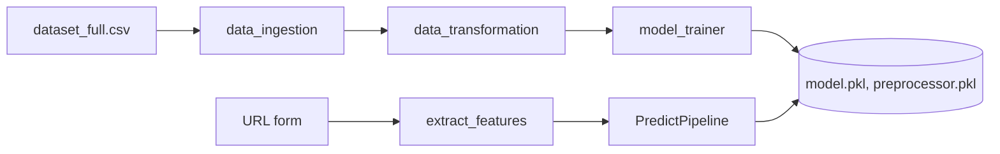

# Phishing Domain Detection

A machine-learning web app that takes a URL, extracts lexical features from it and predicts whether it is likely to be a phishing website.

## What it does
The user enters a URL in a Flask page; `extract_features` (in `src/pipelines/prediction_pipeline.py`) derives URL-based features, the saved preprocessor and model score it, and the page shows either "may be a phishing website, be aware" or "safe".

## Features
- Modular ML pipeline: data ingestion, transformation (preprocessor object), model trainer, training pipeline and prediction pipeline.
- Model trainer compares several classifiers (Random Forest, Gradient Boosting, XGBoost, SVC, AdaBoost, Decision Tree; KNN commented out) and keeps the best.
- Custom logging and exception modules; `setup.py` for packaging.
- Dataset: URL-feature dataset (`notebooks/data/dataset_full.csv`, split 70/30, `random_state=42`) - the notebook folder includes the figure from the public dataset paper.
- AWS Elastic Beanstalk config (`.ebextensions/python.config`); the original README states it was deployed on Elastic Beanstalk with CodePipeline (ap-south-1), which may no longer be live.
- Design docs (architecture, HLD, LLD, wireframe, report, demo video) in `Documentation/`.

## Flow


## Tech stack
Python, pandas, NumPy, scikit-learn, XGBoost, Flask, AWS Elastic Beanstalk. (`requirements.txt` lists only pandas, numpy, scikit-learn, Flask - add `xgboost`.)

## Structure
```
application.py            # Flask app
src/components/           # data_ingestion, data_transformation, model_trainer
src/pipelines/            # training_pipeline, prediction_pipeline
src/{logger,exception,utils}.py
artifacts/                # model, preprocessor, train/test CSVs
notebooks/                # EDA notebook + datasets
templates/index.html
Documentation/            # docs, pptx, demo video
```

## Run
```bash
pip install -r requirements.txt xgboost
python src/pipelines/training_pipeline.py   # optional retrain
python application.py                       # http://localhost:5000
```

## Limitations
No reported evaluation metrics in the repo; features are purely URL-lexical; large binaries committed (see verdict); `debug=True` in the server.
